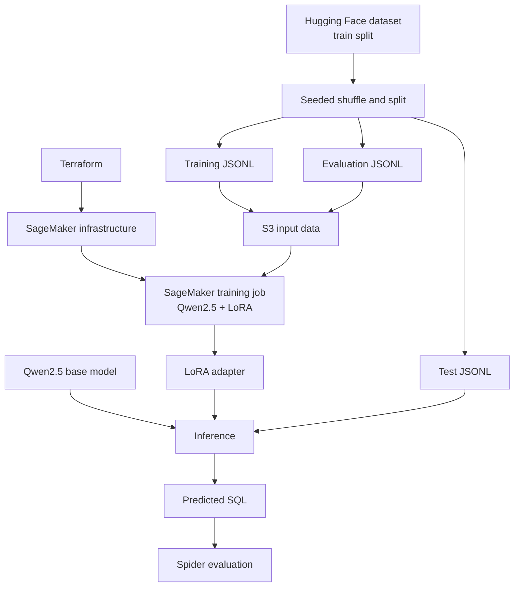
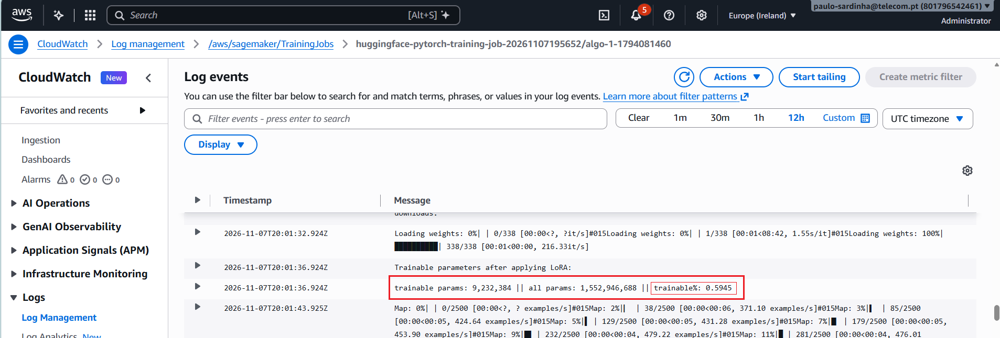
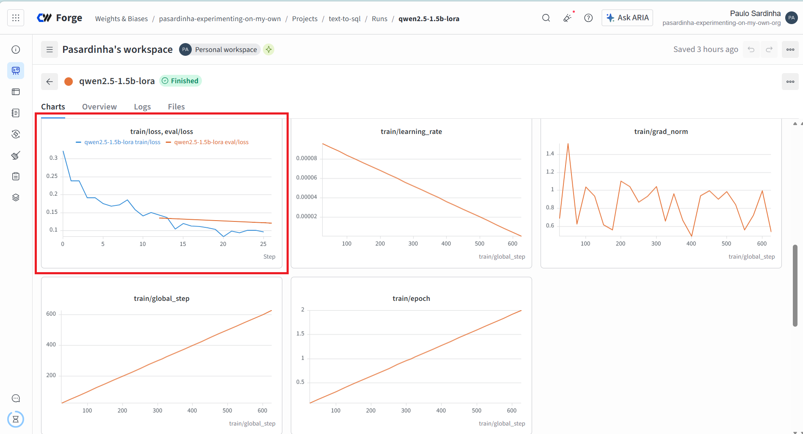
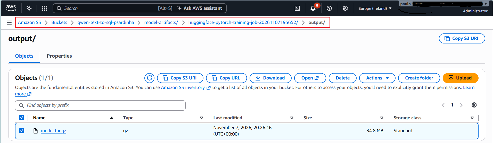

# Schema-Aware Text-to-SQL with Qwen2.5 and LoRA

[](https://www.python.org/)
[](https://pytorch.org/)
[](https://huggingface.co/docs/datasets/)
[](https://aws.amazon.com/sagemaker/)
[](https://developer.hashicorp.com/terraform)
[](https://wandb.ai/site)
[](https://yale-lily.github.io/spider)

Fine-tune **Qwen2.5-1.5B-Instruct** to translate natural-language questions into SQL using database schema context. Training runs on **Amazon SageMaker** with **LoRA** adapters, and generated queries are evaluated with the Spider evaluation framework.

This project demonstrates an end-to-end language-model adaptation workflow: preparing reproducible data splits, configuring parameter-efficient training, provisioning AWS resources with Terraform, launching a managed GPU job, and evaluating model outputs.

## Results at a glance

Both models were evaluated on the same 350 held-out examples. The LoRA-adapted model achieved substantially higher execution and exact-match accuracy than the untuned base model, showing the potential of parameter-efficient fine-tuning to improve Text-to-SQL performance.

| Model | Execution accuracy | Exact-match accuracy |
|---|---:|---:|
| Qwen2.5-1.5B-Instruct (base) | 25.1% | 20.0% |
| Qwen2.5-1.5B-Instruct + LoRA | **66.0%** | **57.4%** |
| Difference | **+40.9 percentage points** | **+37.4 percentage points** |

These results are from the project's experimental evaluation, not a claim of leaderboard performance. The examples were sampled from the Hugging Face dataset's `train` split; using the Spider evaluator does not make this the official Spider test set.

## How it works

Each training example combines a database identifier, its schema, a natural-language question, and the reference SQL query. The model receives the schema and question and is trained to return SQL only.

The training script adapts the base model with **Low-Rank Adaptation (LoRA)** rather than updating every model parameter. The experiment configuration is:

| Parameter | Value |
|---|---|
| Rank (`r`) | 8 |
| Alpha (`lora_alpha`) | 16 |
| Dropout (`lora_dropout`) | 0.05 |
| Target modules | `q_proj`, `k_proj`, `v_proj`, `o_proj`, `gate_proj`, `up_proj`, `down_proj` |

The base weights are frozen while small trainable updates are learned for these attention and MLP projections. The training code masks prompt tokens in the labels so the loss is applied to the SQL response.

The SageMaker launch script uploads the JSONL training and evaluation inputs to S3, starts a managed Hugging Face training job, and writes model artifacts to S3. W&B/Weave tracking can be used for training metrics and experiment traces.

### Architecture



## Repository map

| Path | Purpose |
|---|---|
| [peft/get_ds.py](peft/get_ds.py) | Downloads, shuffles, partitions, and exports the dataset as JSONL |
| [sagemaker/launch_training.py](sagemaker/launch_training.py) | Uploads data and submits the SageMaker training job |
| [sagemaker/run_perf.py](sagemaker/run_perf.py) | Loads the model and data, configures LoRA, trains, and saves the adapter |
| [peft/run_perf_locally.py](peft/run_perf_locally.py) | Local LoRA training workflow |
| [evaluate/evaluate.py](evaluate/evaluate.py) | Runs inference and writes JSONL plus Spider-format prediction files |
| `infrastructure/` | Terraform configuration for the S3 bucket and SageMaker role |
| `data/` | Prepared training, evaluation, and test JSONL files |
| `output/` | Recorded predictions and Spider-format evaluation inputs |
| `docs/` | Training and experiment screenshots |

## Requirements

- Python **3.12**
- [`uv`](https://docs.astral.sh/uv/)
- For cloud training: AWS credentials, Terraform **1.5+**, and permissions to create/use the configured S3, IAM, Secrets Manager, and SageMaker resources (unless you remove the W&B configuration as described below)
- For local inference and training: a machine with sufficient memory for the base model and training workload. GPU or Apple Silicon acceleration is optional, although CPU training and inference can be considerably slower.
- For Spider evaluation: the Spider repository and its database assets at the paths described below

Install the project dependencies:

```bash
uv sync
```

### Prepare AWS infrastructure

The Terraform configuration and training launcher use the `eu-west-1` region. By default, Terraform requires an existing Secrets Manager secret named `wandb-api-key` containing a W&B API key. To use W&B, create the secret before provisioning, and do not put API keys in source files or commit them.

W&B is not required for training. To disable it, remove the `aws_secretsmanager_secret.wandb` data source from [infrastructure/main.tf](infrastructure/main.tf), remove the Secrets Manager permission statement referencing that data source from `aws_iam_role_policy.project_access`, and remove the `wandb_secret_arn` output from [infrastructure/outputs.tf](infrastructure/outputs.tf). The training launcher already treats a missing `wandb_secret_arn` output as W&B being disabled.

Before provisioning, verify that the S3 bucket name configured in [infrastructure/main.tf](infrastructure/main.tf) is globally unique and that the SageMaker instance is available to your AWS account and region. Review the Terraform plan and expected AWS costs before applying:

```bash
terraform -chdir=infrastructure init
terraform -chdir=infrastructure validate
terraform -chdir=infrastructure plan
terraform -chdir=infrastructure apply
```

When W&B is configured, Terraform supplies the secret ARN to the SageMaker job, which retrieves the key at runtime.

The training launcher uses a `ml.g5.xlarge` instance with managed Spot Training and a two-hour maximum runtime (three-hour maximum wait). AWS charges may apply for training and related resources.

## Prepare the datasets

[peft/get_ds.py](peft/get_ds.py) shuffles the `train` split of [`Turbular/fixed_spider`](https://huggingface.co/datasets/Turbular/fixed_spider) and partitions the shuffled examples into train, evaluation, and test JSONL files. These are project-specific random subsets of the dataset's `train` split, **not** the official Spider train/dev/test partitions. The split is disjoint at the example level, but it does not group by database: examples from the same database/schema may occur in multiple subsets. The default shuffle seed is `321`; set `--seed` to reproduce a particular split or choose a different one.

For example, create a 2.500-example training set and 350-example evaluation and test sets:

```bash
uv run python peft/get_ds.py \
  --output_train_file data/train.jsonl \
  --num_train_samples 2500 \
  --output_eval_file data/eval.jsonl \
  --num_eval_samples 350 \
  --output_test_file data/test.jsonl \
  --num_test_samples 350 \
  --seed 321
```

The evaluation split is used during training to monitor validation loss and select checkpoints. Keep the test split out of training and model selection; use it for the final comparison.

Each JSONL record contains:

```json
{
  "db": "database_id",
  "schema": "database schema definition",
  "question": "natural-language question",
  "output": "SELECT ..."
}
```

## Train on SageMaker

After preparing `data/train.jsonl` and `data/eval.jsonl` and applying the infrastructure, submit the training job:

```bash
uv run python sagemaker/launch_training.py
```

The following configuration is used:

|Training setting	|Value|
|-----------------|---:|
|Epochs           |	2|
|Training examples|	2.500|
|Evaluation examples|	350|
|Test examples|	350|
|Dataset shuffle seed|	321|
|Training hardware|	`ml.g5.xlarge`|


The launcher reads the S3 bucket and SageMaker execution role from Terraform outputs, uploads the input files, and starts [sagemaker/run_perf.py](sagemaker/run_perf.py) in an AWS Hugging Face Deep Learning Container. The configured run fine-tunes `Qwen/Qwen2.5-1.5B-Instruct` for two epochs with LoRA rank 8 and saves its model artifacts to S3. If W&B is configured, training metrics can also be monitored in your W&B workspace.

The trained adapter is a delta to the base model, not a standalone full model: it does **not** include Qwen's original model weights. The recorded adapter weights are approximately 36 MB, but adapted inference still downloads and loads `Qwen/Qwen2.5-1.5B-Instruct` before applying the adapter. Download the SageMaker `model.tar.gz` artifact and extract it to `qwen2.5-1.5b-lora/` before running adapted-model inference. The adapter directory should contain `adapter_config.json` and `adapter_model.safetensors`, along with the tokenizer files.

### Train locally

Training can also be performed locally using [peft/run_perf_locally.py](peft/run_perf_locally.py). After installing dependencies with `uv sync`, prepare `data/train.jsonl` and `data/eval.jsonl`, then run from the project root:

```bash
uv run python peft/run_perf_locally.py
```

The script selects CUDA, Apple Silicon (MPS), or CPU when available and saves the adapter under `qwen2.5-1.5b-lora/`. Unlike the SageMaker script, the current local script initializes W&B/Weave directly and reads its API key from `WANDB_API_KEY`, prompting for it if the variable is unset. Local training compute and memory requirements depend on the selected device and dataset size.


## Run inference and evaluate

The evaluation script loads the base model and, optionally, a LoRA adapter. It writes:

- A JSONL file containing each example and its generated `prediction`.
- A Spider gold file (`SQL<TAB>database_id`).
- A prediction text file with one generated SQL query per line.

Run the base model on the held-out test file:

```bash
uv run python evaluate/evaluate.py \
  --use-lora False \
  --trim True \
  --eval-file data/test.jsonl \
  --output-file output/base_test_predictions.jsonl \
  --gold-file output/base_gold.sql \
  --pred-file output/base_predictions.txt
```

Run the adapted model on the same file:

```bash
uv run python evaluate/evaluate.py \
  --use-lora True \
  --adapter-dir qwen2.5-1.5b-lora \
  --trim True \
  --eval-file data/test.jsonl \
  --output-file output/lora_test_predictions.jsonl \
  --gold-file output/lora_gold.sql \
  --pred-file output/lora_predictions.txt
```

`--trim True` removes Markdown SQL fences (\`\`\`sql prefix and \`\`\` suffix) when the model includes them. The default adapter directory is `qwen2.5-1.5b-lora`; pass `--use-lora False` to evaluate the untuned base model.

### Run the Spider evaluator

Place the [Spider repository](https://github.com/taoyds/spider) at `spider/` and its database assets at `spider_data/`, including `spider_data/database/` and `spider_data/tables.json` so that project file hierarchy becomes:

```text
  Project root
    ├── ...
    ├── spider
    ├── spider_data
    └── ...
```

Install the NLTK tokenizer data required by the evaluator:

```bash
uv run python -c "import nltk; nltk.download('punkt_tab')"
```

Then evaluate each model's predictions:

```bash
uv run python spider/evaluation.py \
  --gold output/base_gold.sql \
  --pred output/base_predictions.txt \
  --etype all \
  --db spider_data/database \
  --table spider_data/tables.json

uv run python spider/evaluation.py \
  --gold output/lora_gold.sql \
  --pred output/lora_predictions.txt \
  --etype all \
  --db spider_data/database \
  --table spider_data/tables.json
```

The Spider evaluator reports three types of metrics:
- **Execution accuracy (EX)**: Measures whether the predicted SQL produces the same result as the reference query when executed against the corresponding database.
- **Exact-match accuracy (EM)**: Measures whether the predicted SQL matches the reference according to the Spider evaluator's SQL structural comparison methodology.
- **Partial-match metrics**: Evaluate individual SQL components, such as SELECT, WHERE, GROUP BY, ORDER BY, and other structural elements.


## Training experiment

LoRA substantially reduces the number of trainable parameters compared with full fine-tuning. The example training output and experiment screenshots are included here:



In this configuration, approximately 9 million parameters (less than 0.6% of the model's total parameters) are trainable. The remaining parameters are frozen during training. The recorded run used a deliberately small training budget to limit cloud costs. 

The training evolution can be accompanied live in [W&B](https://forge.coreweave.com/wandb):



Artifacts resulting from training are produced in S3:



They must be download and expanded to [qwen2.5-1.5b-lora](qwen2.5-1.5b-lora) directory to be available for local execution.

## Future work

- Train for more than two epochs while monitoring validation loss and held-out execution accuracy.
- Compare LoRA rank 16 with the current rank 8 configuration.
- Measure how training-set size affects quality, keeping validation and test examples fixed.

## Data and model references

- Base model: [`Qwen/Qwen2.5-1.5B-Instruct`](https://huggingface.co/Qwen/Qwen2.5-1.5B-Instruct)
- Dataset: [`Turbular/fixed_spider`](https://huggingface.co/datasets/Turbular/fixed_spider)
- Benchmark: [Spider: A Large-Scale Human-Labeled Dataset for Complex and Cross-Domain Semantic Parsing and Text-to-SQL Task](https://aclanthology.org/D18-1425/) (Yu et al., EMNLP 2018)
- SageMaker Hugging Face containers: [Hugging Face DLC documentation](https://huggingface.co/docs/sagemaker/get-started/dlcs)

## Limitations

This is an experimental fine-tuning workflow, not a production SQL execution service. Generated SQL should be validated and executed with appropriately restricted database permissions. The reported metrics reflect one limited run and a sampled dataset split; results can vary with the split, training configuration, hardware, and inference settings.
